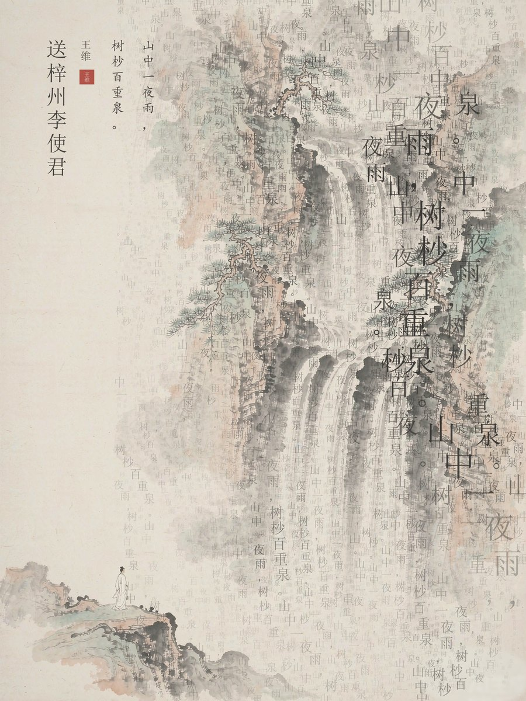
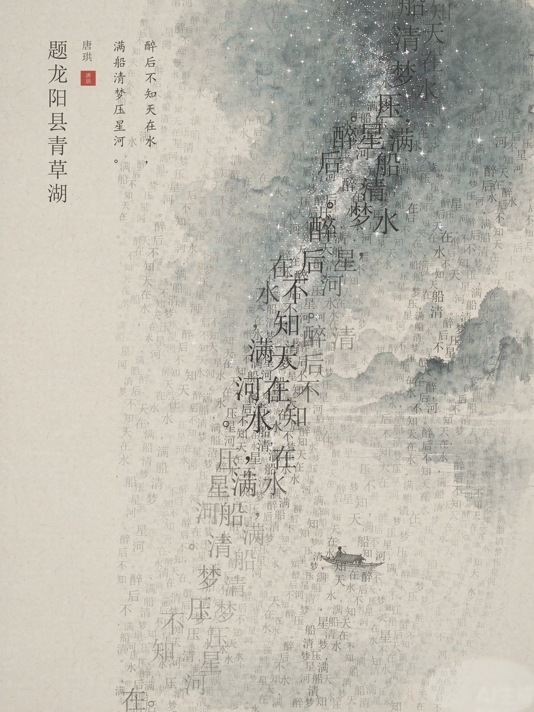

# 诗句山河 · 水墨字景

> 把一句诗变成一幅画：**山水是底，诗句是水**。

输入一句诗，自动生成一张 3:4 的水墨字景图——文字不横排也不竖排成方块，而是**顺着画面里景物的线条流动**：沿瀑布垂落、随山脊盘旋、贴水波荡漾、跟枝梢弯垂。近处字大墨浓，远处字小如雾，整句诗反复循环铺陈，形成一条条会呼吸的"字河"。左侧一条窄窄的竖排版式：诗题、作者、朱印、诗句原文。





---

## 它到底怎么做的

不是把文字贴到图上，而是让文字**长在景物的纹理上**：

1. **方向场** — 对底图求结构张量，得到沿笔触/水纹的切向场，再与全局流向混合。瀑布处字就垂落，水波处字就横铺。
2. **骨架追踪** — 把文字区切成网格，每格取纹理最强点作种子，顺着方向场往下"放线"，得到二十余条骨架曲线。
3. **法向字带** — 每条骨架向两侧平移出多条平行字列，两端自动收窄成河道锥度，列距随机抖动形成疏密。
4. **四层墨色** — 大字链 → 中字 → 碎字 → 远景雾，由内向外逐层变宽变淡；字号和墨色同时受局部纹理强度、画面亮度、低频斑驳场控制，所以有"近浓远淡"的呼吸感。
5. **左侧版式** — 竖排诗题 → 作者 + 朱红方印 → 诗句分列，全部自动排版。

---

## 依赖

- Python 3.9+
- Pillow、numpy

```bash
pip install pillow numpy
```

中文字体：脚本会自动查找（Windows `simsun`/`simkai`、macOS `Songti.ttc`、Linux `NotoSerifCJK`）。
找不到时用环境变量指定：

```bash
export SHICI_FONT_SONG=/path/to/中文字体.ttf
export SHICI_FONT_KAI=/path/to/楷体.ttf
```

---

## 安装

### 方式一：作为 WorkBuddy 技能（推荐）

把整个 `shici-river-ink` 文件夹复制到技能目录：

| 系统 | 路径 |
|---|---|
| Windows | `%USERPROFILE%\.workbuddy\skills\` |
| macOS / Linux | `~/.workbuddy/skills/` |

重启 WorkBuddy，之后直接说「把这首诗做成字景图」就会自动调用。

### 方式二：命令行直接用

拷到任意位置，`cd` 进 `scripts/` 即可，无需安装。

---

## 三步出图

### 第 1 步 · 准备一张水墨底图

任何 3:4 的水墨/淡彩图都行。要点：

- **左侧约 1/4 留白**，给标题让位
- **景物要有明确的线条**（瀑布、水纹、山脊、枝条）——引擎靠这些线找字流，雾蒙蒙一片的图出不来效果
- **画面上不能有文字**，否则会和字流打架
- **左下角有个极小的身影**最理想（诗人）

可以用任何 AI 绘图工具生成，提示词参考 `references/imagery-recipes.md` 里的 10 类配方。

### 第 2 步 · 合成

```bash
python scripts/inkflow.py \
  --base "底图.png" \
  --out  "成品.png" \
  --title "送梓州李使君" \
  --author "王维" \
  --lines "山中一夜雨，|树杪百重泉。" \
  --preset waterfall \
  --seed 11
```

- `--lines` 用 `|` 分隔竖列，**第 1 句排最右列**（符合竖排从右往左读）
- 换 `--seed` 出完全不同的构图，一首诗可以多跑几版挑一张

### 第 3 步 · 出图

默认成品 2304×3072，可直接印刷或投屏。想要更快预览加 `--ss 1`。

---

## 参数

| 参数 | 默认 | 说明 |
|---|---|---|
| `--preset` | 无 | 题材预设，覆盖流向/平滑/斑驳三项 |
| `--lines` | — | 竖排列，`\|` 分隔 |
| `--title` / `--author` | 空 | 左侧竖排标题与作者（两字会生成朱印） |
| `--seed` | 7 | 构图随机种子 |
| `--ss` | 2 | 超采样倍数，2=高清，1=快速 |
| `--width` | 1152 | 逻辑宽度，成品宽 = width × ss |
| `--density` | 1.0 | 字列疏密倍数 |
| `--spine-count` | 22 | 骨架条数，越大细节越碎 |
| `--flow-bias` | 0.40 | 全局流向权重：1=完全顺景物，0=完全顺重力 |
| `--blotch` | 7 | 墨色斑驳尺度，大=块更大更写意 |
| `--layers` | big,mid,mist,veil | 只渲染某几层调试 |
| `--debug` | — | 打印每条字流落字数 |

### 题材预设

| preset | 适用 | 字流形态 |
|---|---|---|
| `waterfall` | 瀑布、山涧、夜雨 | 竖直垂落，略偏右下 |
| `water` | 湖、江、池塘、涟漪 | 横向荡漾 |
| `star` | 星河、夜空、梦 | 斜向倾泻 |
| `garden` | 庭院、花木、雨檐、垂柳 | 多方向垂落 |
| `mountain` | 山路、峰峦、登临 | 顺山脊盘绕 |

---

## 常见问题

**字糊成一片灰？**
降 `--density 0.8`，或 `--blotch 10` 让浓淡块更大。

**字太散，读不出句子？**
提高 `--flow-bias 0.6`，`--spine-count` 降到 12。

**字流方向不对（该竖的反倒横）？**
换 `--preset`；或 `--field-sigma` 调小到 8–12，让方向更贴局部。

**文字压住标题了？**
加大 `--text-x-min`（默认 0.225）到 0.26。

**出图很慢？**
`--ss 1` 预览，定稿再 `--ss 2`。2304×3072 全量约 20 秒。

**想看字流会往哪走？**

```bash
python scripts/debug_field.py 底图.png 方向场预览.png 16
```

右侧每个小线段就是该处文字的走向。

---

## 许可

MIT，随便用、随便改、随便商用，保留署名即可。
